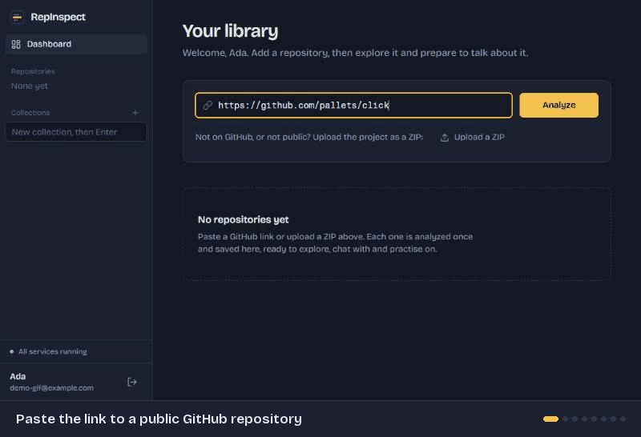

# RepInspect

**Understand the code. Own the interview.**

RepInspect analyzes a GitHub repository (or an uploaded ZIP), maps its structure and
technologies, and answers questions about the implementation with references to the
exact files and lines. It then turns the codebase into interview preparation: a
project report, repository-specific questions and a mock interview with feedback.



> Status: early development. User accounts, GitHub and ZIP import, static code
> analysis, AI explanations, chat and a personal library are in place: save a public
> repository or upload a project, browse its files with an outline of every function
> and class, see its dependencies, frameworks and most important files, get an overview
> and file explanations, ask questions whose answers quote the exact lines they rely on,
> organise it all with labels, notes, collections and version history, and prepare for
> interviews with notes, practice questions and graded mock interviews about the code.
> Login rate limiting, logout revocation, security headers, Docker and CI are in place
> too (see [docs/architecture.md](docs/architecture.md) and [docs/deployment.md](docs/deployment.md)).

## Tech stack

| Layer | Tools |
|---|---|
| Frontend | React, TypeScript, Vite, Tailwind CSS, React Router, TanStack Query, Lucide |
| Backend | Python 3.11, FastAPI, Pydantic, SQLAlchemy 2, Alembic |
| Database | PostgreSQL 17 |
| AI | Google Gemini behind a swappable provider layer; Sentence Transformers (`bge-small-en-v1.5`) and FAISS for search |
| Code analysis | Python `ast`, Tree-sitter (JavaScript, TypeScript, Java), GitHub REST API |
| Testing | Pytest, Vitest, React Testing Library |

## Project layout

```
backend/     FastAPI app, Alembic migrations, pytest suite
frontend/    React + Vite single-page app
docker/      Container init scripts (Postgres)
.github/     CI workflow
docs/        Architecture and design notes
```

## Getting started

### Requirements

- Python 3.11+
- Node.js 20+
- Docker (for PostgreSQL)

### 1. Start the database

```bash
docker compose up -d
```

This starts PostgreSQL on `localhost:5433` with two databases: `repinspect` for
development and `repinspect_test` for the test suite. Port 5433 is used so it does
not clash with a PostgreSQL already installed on your machine; change it with the
`POSTGRES_PORT` environment variable (and update `DATABASE_URL` to match).

### 2. Run the backend

```bash
cd backend
python -m venv .venv
.venv\Scripts\activate          # Windows
# source .venv/bin/activate     # macOS / Linux
pip install -e ".[dev]"
cp .env.example .env
alembic upgrade head
uvicorn app.main:app --reload
```

`.env.example` ships with a development-only `JWT_SECRET` so the app runs locally
straight away. The app refuses to start in production (`APP_ENV=production`) with that
placeholder; generate a real key first:

```bash
python -c "import secrets; print(secrets.token_urlsafe(48))"
```

The API runs at http://localhost:8000. Interactive docs are at
http://localhost:8000/api/docs, and a health check is at `/api/health`.

### 3. Run the frontend

```bash
cd frontend
npm install
npm run dev
```

Open http://localhost:5173. The Vite dev server forwards `/api` requests to the backend,
so both run under one origin in the browser.

## Analyzing GitHub repositories

Log in, paste a public repository URL on the dashboard and press Analyze. The backend
reads the repository in the background and the page shows progress.

- GitHub allows **60 API requests per hour** without a token, shared by everyone on
  your network, and each analysis uses 4. When the limit is hit the page says when to
  try again. For regular use, create a token with no extra permissions at
  https://github.com/settings/tokens and set `GITHUB_TOKEN` in `backend/.env`.
- Only public repositories are supported. Private ones look the same as missing ones.
- Repository code is only ever read as text, never executed. Files such as `.env` and
  private keys are never stored, and secret-looking values in source files are
  replaced with `[REDACTED]`.
- Very large repositories are cut off at the limits in `.env.example` and flagged.

When the import finishes you get three views:

- **Overview**: language breakdown (by lines of code), statistics, the frameworks and
  libraries detected (each with the file and line that proves it), and the files most
  worth reading first, with the reason for each.
- **Files**: a file tree with search, a code viewer, an outline of the functions and
  classes in each file, and its imports. Imports of other files in the repository are
  links, and every file lists the files that import it.
- **Dependencies**: everything declared in `requirements.txt`, `pyproject.toml`,
  `package.json`, `pom.xml` and Gradle files, grouped by manifest and filterable.

Python is parsed with the standard library's `ast` module; JavaScript, TypeScript and
Java with Tree-sitter. Code is only parsed, never run.

## Your library

- **Upload a ZIP** of a project instead of a GitHub link (up to 50 MB). A single
  top-level folder, as in GitHub's "Download ZIP", is dropped. The upload goes through
  the same safety checks as a GitHub download and is deleted once it is unpacked.
- **Refresh** a GitHub repository to analyze its latest commit, or upload a new ZIP of
  an uploaded project. Each refresh is a new version. The previous version stays on
  screen until the new one is ready, and a failed refresh keeps it too.
- **History** lists every version and what changed since the one before: files added,
  changed and removed (compared by content hash), technologies, and dependency versions.
  Older versions keep their file list but give back the disk space of their files.
- **Labels** (up to 10 per repository) and **collections** (named groups, for example
  one per interview) organise the library. The dashboard can search and filter by both.
- **Notes** belong to a repository and survive refreshes. A note can point at a file and
  line: open a file, pick a line, and write the note next to the code.
- **Delete** removes a repository with everything stored for it, on disk too.
- **Practice progress** shows on each library row ("3 of 12 practised"), and the list can
  be sorted with the least practised repository first.
- **Export** the interview notes or a mock interview report as Markdown, or save them as
  a PDF from the print dialog.
- A **dark or light theme** can be chosen with the switch in the sidebar.

## AI explanations

With an AI key configured, each analyzed repository gets three kinds of explanation,
generated on request:

- **How this project works** (Overview tab): ten short sections covering purpose,
  architecture, frontend, backend, data flow, important modules, how it runs and key
  decisions.
- **Technology explanations** (Overview tab): what each detected framework or library
  is, its strengths, alternatives and trade-offs. This is general knowledge and is shown
  apart from the evidence found in the code.
- **Explain this file** (Files tab): purpose, inputs and outputs, and the key functions
  and classes, each a link to its line.

The model only sees facts from the static analysis plus excerpts of the most important
files, never the whole repository. Every quote it gives is checked against the real
file before anything is shown. Claims backed by a confirmed quote are highlighted in
amber with a link to the lines; anything the code does not confirm is marked as
inference, and parts the analyzed files do not answer say so instead of guessing.

### Setting up a Gemini key

1. Create a free key at https://aistudio.google.com/apikey.
2. Add it to `backend/.env` as `GEMINI_API_KEY=...` and restart the backend.

Without a key everything else works and the AI buttons explain that AI is not set up.
The free tier has small daily quotas and is sometimes busy, so the server retries
temporary errors, and each user gets a daily allowance (40 requests by default) with at
most two running at once. These limits are in `.env.example`. On the free tier Google
may use the prompts to improve its products, so do not analyze code you are not allowed
to share.

## Chat with a repository

The Chat tab answers questions about one analyzed repository. After each import the
backend builds a search index of the code (about a minute for a mid-sized repository,
with progress shown on the page). Imports made before chat existed get a "Build the
search index" button instead.

- Files are split into chunks along their functions, classes and Markdown sections, so a
  search result is a whole function rather than an arbitrary slice of lines.
- Each question is matched three ways: by meaning (vectors from a small embedding model
  that runs locally, searched with FAISS), by keywords (Postgres full-text search, with
  `camelCase` and `snake_case` names split into words), and by files or functions the
  question names. The rankings are merged, and the best excerpts go to the model.
- The answer cites the excerpts with markers such as [1]. Every quote is checked against
  the real file before it is shown, unconfirmed citations are removed, and answers the
  code does not support are marked as such. "Searched N parts of the code" shows what
  the search found and why.
- Short follow-up questions ("and where is it called?") are searched together with the
  previous question, and the last few turns are sent along as context.

The embedding model (about 130 MB) is downloaded from Hugging Face the first time an
index is built, into `backend/data/models`. After that it loads from disk and works
offline. Indexing runs on the CPU, and pip installs the CPU-only build of PyTorch on
Windows. Chat questions use the same Gemini key and daily allowance as the AI
explanations.

## Interview preparation

The **Interview** tab turns a repository into material for talking about it:

- **Interview notes**: a short pitch for "tell me about this project", the main flow in
  order, the decisions you should be able to defend (with alternatives and trade-offs),
  technical highlights worth bringing up, and weak spots an interviewer may probe. Every
  statement about the code quotes the lines it relies on; alternatives, trade-offs and
  weak spots are marked as suggestions.
- **Practice questions**: ask for 5, 8 or 12 at a time, optionally by topic
  (architecture, implementation, technology choices, data, testing, security, performance,
  trade-offs) and difficulty. Each question says why an interviewer asks it, lists the
  points a strong answer covers (checked against the code like every other AI answer) and
  likely follow-ups. New requests never repeat earlier questions.
- **Progress**: write your own answer under each question and mark it new, practicing or
  confident. A progress bar and filters show what still needs work. Questions and progress
  belong to the repository, so they stay when you refresh it.

### Mock interviews

Start one from the Interview tab: 3, 5 or 8 questions, optionally at one level. Questions
come from your practice list (the ones you are least sure about first), and more are
written if there are too few. They are asked one at a time, with no hints.

Each answer is graded from 0 to 4 against the question's checked answer points and the
code a search finds for it:

- every specific statement you make is checked: the code agrees, the code says otherwise,
  it is not in the code that was searched, or it could not be checked;
- the points a strong answer would also cover are listed with their code;
- if something important was missing, one follow-up question probes it.

At the end (or when you end it early) a report shows the overall score, scores by topic,
what to work on, statements the code contradicts, and the files to read next.

All of these use the same Gemini key and daily allowance as the other AI features. Each
graded answer counts as one request.

## Running tests

```bash
# Backend (needs the database container running)
cd backend
pytest

# Frontend
cd frontend
npm test
npm run lint
npm run build
```

## Deploying

`docker-compose.prod.yml` builds and runs the database, backend and web server together:

```bash
cp .env.example .env        # set POSTGRES_PASSWORD and JWT_SECRET
docker compose -f docker-compose.prod.yml up -d --build
```

Then open http://localhost:8080. Put TLS in front of it for anything public; see
[docs/deployment.md](docs/deployment.md).

## Configuration

Backend settings are read from environment variables or `backend/.env` (found
relative to the code, so the server can be started from any directory). See
[`backend/.env.example`](backend/.env.example) for the available options. Secrets
(API keys, JWT secret, database password) live only in `.env`, which is git-ignored,
and are never exposed to the frontend.
